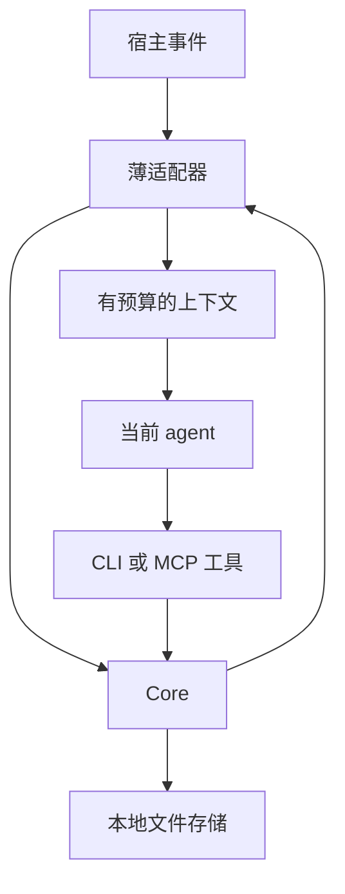

日期：2026-10-10\
目标：将 memory-with-files 从 skills 仓库中的组件整理为可独立安装、升级、停用和卸载的项目。\
适用对象：实现该版本的开发者与 coding agent。

本文定义 0.2.0 的目标行为、接口和发布门槛。文中的新命令及配置属于待实现规范，不代表 0.1.0 已经支持，也不代表 0.2.0 已发布。

## 1 版本目标与核心决策

MWF 是一个以本地文件保存项目记忆、由宿主 agent 使用的工具。0.2.0 保留现有存储核心和 Markdown 记录格式，通过原生插件、扩展和 hooks 接入客户端。程序负责确定性的读取、检索、校验和保存；当前 agent 负责判断什么值得记忆。

| 决策 | 0.2.0 约定 |
| - | - |
| 独立项目 | 目标仓库 `zht7063/mwf`，保留 npm 包名 `@zht7063/mwf`；从现有实现迁移，不从零重写 |
| 默认激活 | Codex 原生插件 hooks；Pi 原生扩展。项目显式启用后才自动工作 |
| 项目规则文件 | 正常安装、初始化、接入、升级和停用均不创建或修改 `AGENTS.md`、`CLAUDE.md` 等规则文件 |
| 数据真相来源 | 现有 Markdown 记录；新交接使用本地 JSON 文件；不引入第二套权威数据库 |
| Core | 无模型、无网络请求、无模型密钥，CLI、MCP 和适配器共用 |
| 分发 | 同一发布版本生成 npm 包、Codex 插件包和 Pi 扩展资产；插件含编译产物与运行依赖 |
| 运行环境 | 统一要求 Node ≥22.19.0；携带 JS 运行文件不等于携带 Node 可执行文件 |
| 交接 | 默认按会话隔离；跨会话任务交接必须显式选择 task ID |
| 上下文 | 摘要优先、正文按需、有限预算、按会话与上下文阶段去重 |
| 卸载 | 停止接入与删除程序分开；记忆、交接默认保留 |

借鉴 Ponytail 的重点是“包内资源 + 宿主生命周期适配”，MWF 的检索、写入和恢复行为应由自己的 Core 实现。参考其[激活 hook](https://github.com/DietrichGebert/ponytail/blob/9b58c1ffb790c075ca32e70a89cf1d80588f4abf/hooks/ponytail-activate.js)与[运行时适配](https://github.com/DietrichGebert/ponytail/blob/9b58c1ffb790c075ca32e70a89cf1d80588f4abf/hooks/ponytail-runtime.js)。不将 Ponytail 的节省比例作为 MWF 的性能承诺。

### 1.1 必须完成

1. 独立构建和安装，脱离原 skills 仓库后仍能运行。

2. 默认不依赖项目规则文件，完成两个目标宿主的自动读取与工具写入。

3. 安装、接入、停用、卸载均有明确所有权和可观察状态。

4. 兼容已有 schema 1 记录，提供旧接入迁移流程。

5. 限制实际输出给模型的上下文，并避免并行会话覆盖进度。

6. 使用真实发布包完成生命周期验收。

### 1.2 明确延后

向量数据库、云端 HTTP 服务、常驻 daemon、后台 LLM 总结、跨项目自动记忆、跨 worktree 自动同步、管理界面、自更新管理器、复杂记忆评分学习，均不进入 0.2.0。

旧 AGENTS 方式最多保留为文档层面的手动兼容说明，不提供静默回退，不纳入默认安装路径。迁移器仅有删除可证明属于旧 MWF 的块的能力。

## 2 实现基线与兼容目标

### 2.1 迁移来源

使用 `zht7063/skills` 的固定提交 `7b8be0e59647c90227c0cb945b279d7fa7ab14ef` 作为审查基线，主要迁移 `packages/mwf`，再吸收顶层安装脚本和 skill 中仍有价值的内容。

现有包为 `@zht7063/mwf@0.1.0`，已经包含 CLI、Core、stdio MCP、编译产物分发与包验收脚本。因此独立化应保留这些基础。参见[现有 package.json](https://github.com/zht7063/skills/blob/7b8be0e59647c90227c0cb945b279d7fa7ab14ef/packages/mwf/package.json)。

| 当前部分 | 迁移方式 |
| - | - |
| `core.ts` | 按用例拆分，保留写入语义；移出 AGENTS、宿主安装和接入检查 |
| `storage.ts` | 保留锁、事务、恢复、幂等和路径保护，先迁移测试再调整边界 |
| `protocol.ts` | 保留 schema 1 解析和状态；将旧规则块逻辑移到迁移模块，修复中文匹配与边界解析 |
| `cli.ts`、`mcp.ts` | 共用新版契约与 Core，不复制业务逻辑 |
| `setup.ts` | 拆成生命周期服务、配置所有权处理器和宿主适配器 |
| `pi-adapter.ts` | 保留薄适配器思路，改用所选 Pi 版本的原生扩展接口 |
| `scripts/install-mwf.ts` | 移除必须从 skills checkout 构建的默认路径，保留 tarball 安装与验证经验 |
| `SKILL.md` 和模板 | 缩减为包内 setup、操作说明和简短使用协议，不向业务项目复制激活规则 |

### 2.2 版本号分别管理

| 字段 | 首版值 | 含义 |
| - | - | - |
| `runtime_version` | `0.2.0` | 程序发布版本，唯一来源为 package metadata |
| `schema_version` | `1` | 现有记忆记录格式，保留在项目配置中 |
| `api_version` | `2` | CLI/MCP/适配器共用的应用接口版本 |
| `receipt_version` | `2` | 新接入和配置所有权记录格式 |
| `handoff_version` | `1` | 新会话／任务交接文件格式 |

适配器与运行时至少核对 API 版本和实际绑定的 root。不得通过修改记录 schema 号来表示“插件升级了”。旧程序不会因为新字段存在就自动停止写入；受支持的迁移流程必须停止旧入口。

### 2.3 宿主与系统范围

| 目标 | 0.2.0 路径与门槛 |
| - | - |
| Pi | 以 `@earendil-works/pi-coding-agent` v1.1.0 为首个兼容基线，使用原生扩展与内置 MCP |
| Codex | 首发验证支持本地插件 command hooks 的桌面工作流；实际客户端构建号、安装来源和重载方式写入兼容矩阵 |
| Codex CLI | 只有通过同样的真实 hook、插件发现及 MCP 测试后才标记支持；不从桌面结果推导 |
| macOS、Linux | 首发验证目标；GUI 与终端分别验证 Node 路径 |
| 旧 Pi、OMP、其他客户端与 Windows | 作为独立兼容目标；未验证时明确标记，不默认宣称支持 |
| 云端编排、纯网页环境 | 不承诺运行本地插件 hooks；可用的手动 MCP 路径应单独说明 |

Pi v1.1.0 的包名和 Node 要求来自其[发布版本 package.json](https://github.com/earendil-works/pi/blob/v1.1.0/packages/coding-agent/package.json)。统一提高到 Node 22.19.0 是为了与该 Pi 基线一致。Codex 插件 hooks 的表面限制与信任要求以[官方打包文档](https://developers.openai.com/plugins/build/plugins#bundled-mcp-servers-and-lifecycle-hooks)为准；发布前必须补上实际运行证据。

## 3 仓库结构与依赖方向

维持一个源码包和一个 package-lock，不为 Core、CLI、MCP 分别建立 npm 包。

| 路径 | 职责 |
| - | - |
| `src/contracts/` | 输入输出 schema、错误码、版本和事件类型 |
| `src/core/` | 记录、交接、检索入口与维护用例 |
| `src/storage/` | 路径边界、事务、锁、journal、幂等 receipt |
| `src/retrieval/` | 资格过滤、匹配、排序、中文词项、事故边界 |
| `src/context/` | 参考 token 计量、预算、正文分页和唯一渲染实现 |
| `src/interfaces/` | CLI、stdio MCP 入口及应用协议转换 |
| `src/integrations/shared/` | 启用状态、root 发现、会话引用、去重和诊断 |
| `src/integrations/codex/` | Codex hook 输入输出与插件资源定位 |
| `src/integrations/pi/` | Pi 扩展事件、命令和 MCP 动态注册 |
| `src/lifecycle/` | init、attach、detach、rebind、migrate、配置所有权 |
| `assets/memory/` | 数据目录初始化模板与 protocol 说明 |
| `assets/skills/` | 包内 setup 与使用说明 |
| `packaging/codex/` | root `plugin.json`、hooks 配置和插件打包模板 |
| `scripts/` | 构建、打包、独立环境验证与发布检查 |
| `tests/` | 存储、检索、生命周期、宿主契约和集成测试 |
| `docs/` | 安装、迁移、协议、架构、兼容矩阵、发布说明 |



依赖方向固定：接口和适配器调用 Core；Core 使用契约、检索和存储。Core 不导入 Codex/Pi SDK，不读取宿主配置，不探测全局插件安装。生命周期模块可以调用 Core 和配置所有权处理器。

适配器不得自行实现第二套记忆格式、排序算法或写入事务。确定性规则落在代码里，包内说明只保留需要 agent 理解和判断的部分。

## 4 数据布局与保存责任

### 4.1 项目目录

| 路径 | 内容与保存规则 |
| - | - |
| `.mwf/config.json` | schema 1 数据配置与可共享运行参数 |
| `.mwf/preferences/`、`decisions/`、`incidents/`、`tasks/`、`knowledge/` | 现有类型的 Markdown 记录 |
| `.mwf/candidates/`、`archive/` | 候选与历史记录 |
| `.mwf/index.md` | 可重建的人工索引；不作为默认全量模型上下文 |
| `.mwf/inbox.md`、`protocol.md` | 保留已有语义，protocol 只说明数据格式和用法 |
| `.mwf/handoff.md` | 旧版交接，只读兼容，不再作为所有会话的当前进度 |
| `.mwf/local/integration.json` | 唯一的本机项目接入状态，`receipt_version: 2` |
| `.mwf/local/handoffs/sessions/` | 按会话保存的持久交接 JSON |
| `.mwf/local/handoffs/tasks/` | 按显式任务保存的持久交接 JSON |
| `.mwf/local/contexts/` | 会话映射、上下文 epoch、有限诊断与自动注入状态 |
| `.mwf/local/transaction.json` 等 | 现有事务恢复所需文件，沿用存储实现 |

`local` 不等于“可随意删除的缓存”。交接、接入所有权和未完成事务均有持久意义；常规清理只能删除明确可重建的缓存。

首次 `init` 必须明确选择 `--git-mode track|ignore`：track 时允许长期记忆进入 Git，但始终忽略 `.mwf/local/`；ignore 时忽略整个 `.mwf/`。不自动 `git add`、commit 或同步。后续 attach 不改变已有 Git mode。

### 4.2 保留现有存储保证

迁移时保留原有规范化 root、路径保护、项目级写锁、原子文件替换、journal 恢复和 request ID 幂等机制。现有实现使用 Node 内置 SQLite 辅助跨进程互斥，权威记忆仍是文件；不要为了名称上的“纯文件”重写这一层。参见[现有存储实现](https://github.com/zht7063/skills/blob/7b8be0e59647c90227c0cb945b279d7fa7ab14ef/packages/mwf/src/storage.ts)。

必须保持以下约束：

- 读取未知的更高数据 schema 时拒绝猜测解析；写入不兼容数据时失败并保留原文件。

- 不跟随项目记忆目录内部的 symlink 越过项目边界。

- 外部编辑与 journal 恢复冲突时报告冲突，不能覆盖用户的新内容。

- 活跃进程仍使用锁时，不删除或替换锁数据库文件。

- 新交接文件也走相同事务通道，不另用裸 `writeFile` 绕过恢复机制。

- secret 检测只处理应写入或返回的记忆内容；不把整个其他 MCP 配置复制进记忆或诊断。

### 4.3 读取和语义写入的责任

插件自动执行的内容限于：识别已启用项目、读取已提交状态、检索、裁剪、注入、记录有限运行元数据。

agent 在当前任务授权范围内负责：保存明确且持久的偏好或结论；将不确定内容写入 candidate；在完成阶段时提交 handoff；遇到冲突时重新阅读和判断。无需为每条已明确授权的记忆另设统一确认弹窗。

Core 不从原始聊天日志、最后一条回复或工具输出中自行生成正式记忆。0.2.0 的恢复保证只覆盖已经成功提交的状态，不覆盖尚未持久化的对话内容。

## 5 项目启用与身份边界

### 5.1 安装和启用分开

安装插件只提供能力。数据目录存在，也不等于允许自动加载。

自动接入的唯一依据为 `.mwf/local/integration.json` 中当前客户端的 `enabled` 状态，示意如下：

```json
{
  "receipt_version": 2,
  "canonical_root": "/absolute/project",
  "clients": {
    "codex": {
      "enabled": true,
      "binding_generation": "unique-binding-generation",
      "runtime_version": "0.2.0",
      "api_version": 2,
      "runtime_path": "/absolute/plugin/runtime/dist/cli.js",
      "owned_resources": [],
      "cleanup_pending": false
    },
    "pi": {
      "enabled": false,
      "owned_resources": [],
      "cleanup_pending": false
    }
  }
}
```

这是字段职责示例。最终 schema 还需容纳必要的所有权值、诊断时间和验证结果，但不得保存其他客户端的凭据或整份宿主配置。

### 5.2 root 发现算法

1. 从宿主提供的 cwd 向上寻找最近的 `.mwf/config.json`，路径先规范化。

2. 找到最近项目后即停止；该项目未启用、配置损坏或不兼容时，不越过它读取父项目。

3. 校验 cwd 位于该 root 内，且 receipt 的 canonical root 与当前 realpath 一致。

4. 确认当前客户端 enabled，并遵守宿主的项目信任状态。

5. 自动 MCP 在读取记忆前，从独立的宿主启动上下文核对当前项目，再绑定此 root；进程存活期间不能通过工具参数改绑。静态配置中的 root 或 generation 不能单独证明当前宿主属于该项目。

写操作必须带明确 root，MCP 请求 root 必须等于启动绑定值。禁止使用“最后活跃项目”、Git remote URL、插件安装目录或 MCP PID 来决定记忆写在哪里。

复制、移动项目或新建 worktree 后应重新 attach/rebind。root 改变时，先将 receipt 中所有客户端标记 disabled/stale，再更新 canonical root，并仅重绑定本次指定客户端；其他客户端不能因共享 root 字段更新而顺便启用。仅一个插件安装路径变化时，则只影响该客户端。

不同 worktree 默认隔离本地状态与交接；Git 对长期记录的同步不等于 MWF 提供自动合并。

每客户端另有 `binding_generation`。初次 attach、disabled→enabled、root 或 runtime 绑定实际变化时生成新的随机 UUID；无变化的重复 attach/rebind 保持原值。自动 MCP 启动时接收该 generation，每次调用及写事务内均与 receipt 比较。旧 generation 返回 `BINDING_STALE`，不能在重新启用后恢复作用。该字段用于撤销旧连接，不替代宿主 root 校验。

### 5.3 会话身份传递

宿主提供的 session ID 与 MCP 协议连接 ID 不是同一概念。统一编码规则为：`session_key = sha256(UTF8(JSON.stringify([client, host_session_id, stable_branch_id_or_null])))`；`session_ref = "s_" + sha256(UTF8(JSON.stringify([canonical_root, session_key])))`。只使用稳定的分支／子代理身份，不把每轮变化的叶节点当作 session ID。模型不得自行猜测宿主 ID。

适配器首次识别已启用会话时，在项目锁内创建或验证 `.mwf/local/contexts/<session_ref>.json`，保存 canonical root、client、原始宿主身份、session_key 和 session_ref。MCP 读取此映射并核对 root、client 与重新计算的值；不存在或不一致的引用拒绝用于 save。session handoff 的 `scope.id` 固定为 session_key。

Pi 可以在注册会话级 MCP 时显式传递会话引用。Codex 的永久项目 MCP 配置只固定 root；hook 将本次 `session_ref` 提供给当前 agent，相关工具调用显式携带它。该引用是应用层路由信息，不是认证凭据。

取不到可靠 session ID 时，允许项目级 bootstrap/recall，但不自动选择会话交接。交接操作需显式 task ID，否则返回 `CONTEXT_REQUIRED`。不自动使用“最新一份交接”。

list/read 的历史目标使用 `target_scope: {kind, id}`，与 save 使用的当前 `session_ref` 或显式 `task_id` 分开。读取旧 session 的 scope ID 不能被当成当前会话写入引用。Codex 若不能在工具入口独立认证调用者身份，session_ref 只承诺正确路由和项目内校验，不宣称阻止模型选择另一已登记会话；Pi 能绑定原生上下文时应同时校验当前会话。

## 6 会话交接契约

### 6.1 作用域与文件

作用域选择顺序：显式 `task_id` 优先；否则使用已验证 `session_ref` 对应的 session；两者均无则不能写 handoff。

session 文件名为第 5.3 节的 session_key；task 文件名为 task ID UTF-8 字节的 SHA-256，task scope.id 保留原始 task ID。ID 不直接拼接路径。两者都位于当前项目下，防止同名任务跨项目串读。

```json
{
  "handoff_version": 1,
  "scope": { "kind": "task", "id": "mwf-0.2-lifecycle" },
  "revision": 1,
  "updated_at": "2026-10-10T09:10:00Z",
  "written_by_session_ref": "opaque-session-reference",
  "data": {
    "goal": "完成配置所有权改造",
    "completed": ["JSON key 级所有权已实现"],
    "decisions": ["未拥有的字段保持原值"],
    "blockers": [],
    "next_action": "补充 TOML 安装与卸载验收",
    "relevant_ids": []
  }
}
```

保留现有 goal、completed、decisions、blockers、next_action、relevant_ids 语义。新增 revision，不建立事件溯源系统。

初始输入上限：goal/next_action 各 2,000 字符；列表最多各 20 项、每项最多 1,000 字符；relevant_ids 最多 50 个；整个交接 JSON 最多 64 KiB。写入超限时返回 `INPUT_TOO_LARGE`，不截断后假装保存成功。

### 6.2 并发写入

`handoff save` 必须提供 `expected_revision`。新建传 0，成功后变为 1；更新传上次读取值。比较与写入在同一个项目锁和事务内完成。

不匹配时返回 `HANDOFF_CONFLICT`，保留当前文件并返回最新 revision。调用者应重新读取并判断如何合并，不能自动用新 revision 重试原覆盖内容。对已经完成的同 request ID 重试，先重放原结果，再对新的提交检查 revision，避免把成功提交的重试误判为冲突。

普通记录 update 同样增加可选 `expected_content_hash`；自动 agent 更新已有记录时必须使用它。继续保留 request ID 的重试幂等，区分“同一提交重试”和“另一份内容覆盖”。

### 6.3 恢复规则

- 恢复同一宿主 session：读取该 session 对应的 handoff。

- 新会话续做旧任务：显式指定 task ID，读取 task handoff。

- 新会话只知道旧 session：先显式 list/read，再由 agent 保存到当前 session 或选定 task；不隐式改绑全局当前任务。

- `.mwf/handoff.md` 存在时返回 `legacy_handoff_available`，仅在明确请求时读取。

- 旧交接迁入新任务通过正常读取和保存操作完成；Core 不猜测任务归属。

默认 list 仅返回作用域 ID、revision、时间和短目标，最多 20 项，并同时遵守 recall 输出预算；按作用域 ID 稳定排序分页。handoff read（包括 legacy）遵守 get 预算，超限复用带版本和字符偏移的 cursor；部分正文以字符串片段返回，始终保留 scope/revision/hash，不能把截断 JSON 冒充完整 data。停用或卸载后保留交接文件。

Codex 子代理在未完成独立会话识别验证前，不自动写主会话 handoff。若宿主不能在工具入口区分调用者，这属于默认工作协议限制，不能宣称为已强制实施的权限隔离。

## 7 检索与上下文预算

### 7.1 三层读取接口

| 操作 | 默认内容 |
| - | - |
| `bootstrap` | 选定作用域的交接摘要、少量全局记忆；有真实任务查询时加入相关摘要 |
| `recall` | ID、类型、状态、摘要、匹配原因、内容哈希与必要事故边界 |
| `get` | 明确 ID 的正文，超限时使用版本固定的 cursor 分段读取 |

bootstrap 不再返回完整 index。recall 默认不返回 body。get 必须明确 ID，不能被当成无条件全库导出接口。

缺少任务查询时，只检索全局合格记忆和选定 handoff；首次取得实际任务后仍可执行 recall，不能被“启动已 bootstrap”这一布尔值阻止。

### 7.2 默认上下文资格

| 类型 | 默认允许状态 |
| - | - |
| preference、knowledge | stable |
| decision | accepted |
| incident | open、resolved，始终保留真实状态 |
| task | planned、active、blocked |

candidate、proposed decision 只在显式 `mode: review` 下参与；deprecated、superseded、obsolete、completed 只在 `mode: history` 下参与。get 不绕过这些模式限制。

open incident 不能被包装成已验证修复方案。任务状态和故障状态属于上下文数据；用户当前指令和正式项目规则优先。

### 7.3 中文、结构化匹配和事故边界

保留可解释的打分框架，先做小范围确定性修复：

1. 文本 NFKC 标准化并转小写；拉丁字母和数字按词项处理，连续汉字生成 bigram；单汉字只用于显式 keyword 或完整单字查询。

2. 显式 tool/component 参数使用标准化后的精确匹配；从自然语言查询匹配英文标识时要求词边界。

3. 保留 keyword 对明确中文短语的匹配，不引入自动翻译或跨语言语义检索。

4. path 保持规范化后的 glob 规则；在输入明确 path 且记录限定 paths 时，路径不匹配的记录默认不自动注入，review 可解释其被排除的原因。

5. 其他 scope 字段继续作为路由证据，不能把任何单一关键词命中当作适用性已验证，也不能把 scope 当作文件访问权限边界。

6. 事故标题使用互斥的标准化映射；`Invalid when` 只属于失效条件。支持“适用范围／适用条件／适用边界”和“失效条件／失效边界／不适用条件”。

缺少适用或失效条件时标记 `complete: false`，doctor 提供具体记录 ID。正文未知标题保留原文，不猜测分类。现有缺陷位置见[protocol.ts](https://github.com/zht7063/skills/blob/7b8be0e59647c90227c0cb945b279d7fa7ab14ef/packages/mwf/src/protocol.ts#L289-L316)。

### 7.4 固定预算和计量口径

以下是初始工程默认值，需要通过基准调整，不代表所有模型的实际 tokenizer：

| 用途 | 参考 token 上限 | UTF-8 硬上限 |
| - | - | - |
| 自动 bootstrap | 1,024 | 8 KiB |
| recall | 2,048 | 16 KiB |
| 显式 get | 4,096 | 32 KiB |
| 用户显式扩大单次读取 | 最大 8,192 | 最大 64 KiB |
| 单一 context epoch 的自动追加总量 | 8,192 | 同时累计报告 bytes |

实现一个固定版本的离线参考 tokenizer，计量标识为 `o200k_base`；依赖和词表必须随包锁定、离线可用。输出使用 `reference_tokens` 名称，不能声称等于所有模型的计费 token。若宿主提供更严格限制，取两者较小值。

预算覆盖最终发送给模型的完整序列化文本，包括简短协议、元数据和提示。一个适配器事件合并为一个受限包，不通过拆成多个输出绕过上限。不可同时重复输出含相同正文的 `context_text` 和 JSON。

按完整条目、字段或段落优先裁剪；超长单段或单行允许按 Unicode code point 分片，不能切断字符。必须返回 `partial`、省略数量和可继续读取方式。事故边界放不下时，不得只留下修复步骤并暗示条件完整。无结果且无 handoff 时，不注入“暂无记忆”的长模板。显式读取预算连最小有效输出都放不下时返回 `BUDGET_TOO_SMALL`，不能返回不前进的 cursor。

### 7.5 去重由适配器管理

去重键包括 canonical root、session 身份、context epoch、record ID、content hash 和 detail level。摘要已加载不阻止读取正文，内容变化后允许重新加载。

每次自动输出的有效预算为单次上限与当前 epoch 剩余额度的较小值，放不下最小有效输出时跳过。在项目锁内读取额度、对候选内容裁剪并原子预留预算，登记 pending 输出及暂时去重键，防止并发 hook 重复追加或合计超额。

输出后记录 submitted，能够取得宿主确认时再升级为 accepted；预算预留不等于已读取。已确认未输出的失败可释放预留；崩溃或输出结果不明时保守保留额度占用并标记 unknown，由明确重试或下一 epoch 恢复，不伪造已读。Core 返回结果不等于模型已经读过。

压缩、恢复、clear、session replacement 或分支上下文重建时切换 epoch，必要内容可重新加载。自动注入累计预算用尽后停止自动追加；显式 recall/get 仍可使用。没有可靠生命周期事件的适配器不得使用永久去重状态。

## 8 Core API 与工具契约

### 8.1 共用结果外层

CLI 和 MCP 使用同一输入 schema、同一 execute 层与错误码，结果示意：

```json
{
  "ok": true,
  "operation": "recall",
  "runtime_version": "0.2.0",
  "api_version": 2,
  "schema_version": 1,
  "project_root": "/absolute/project",
  "data": {
    "entries": [],
    "budget": {
      "limit_reference_tokens": 2048,
      "used_reference_tokens": 120,
      "tokenizer_id": "o200k_base",
      "max_output_bytes": 16384,
      "output_bytes": 450
    },
    "omitted": { "by_budget": 0, "by_status": 0, "already_loaded": 0 },
    "partial": false
  },
  "warnings": []
}
```

示例数字只展示字段关系。实际计量必须基于最终输出，并与测试一致。MCP 的 structuredContent 与模型可见内容通过同一渲染器产生，确保没有重复正文，也不遗漏状态与 partial 标记。

摘要 entry 至少包含 `id/type/status/summary/content_hash/reasons`；事故 entry 另含 `boundaries` 和完整性标记。正文 cursor 包含 ID、content hash 和下一 Unicode code point 偏移；续读必须前进，内容改变返回 `RECORD_CHANGED`。handoff cursor 另带 scope/revision，使用相同切分规则。

### 8.2 默认 agent 工具

默认 MCP profile 仅暴露以下 8 个工具，避免把安装和大量管理工具常驻模型上下文：

| 工具 | 职责 |
| - | - |
| `mwf_bootstrap` | 手动恢复或验证，与自动 hook 共用 Core |
| `mwf_recall` | 有预算的摘要检索 |
| `mwf_get` | 显式读取正文或续页 |
| `mwf_add` | 写入符合类型状态的记录 |
| `mwf_propose` | 保存待确认候选 |
| `mwf_update` | 修改记录、状态或晋升候选，支持内容版本冲突检查 |
| `mwf_handoff` | `list/read/save`，显式 session/task 作用域；read 可显式选择 legacy |
| `mwf_status` | 当前 root、运行版本、能力和接入状态 |

维护操作 `process-inbox/duplicates/compact/rebuild-index/migrate/forget/doctor` 保留在 CLI；只有显式 maintenance profile 才暴露相应 MCP 工具。init、attach、detach、rebind 不进入默认 agent 工具集。

所有工具保留清晰的 schema 描述和合适的 MCP annotations。工具注释只是能力声明，不代替 Core 的输入验证、root 检查或宿主授权。

### 8.3 错误语义

至少提供：`NOT_INITIALIZED`、`INTEGRATION_DISABLED`、`ROOT_MISMATCH`、`BINDING_STALE`、`RUNTIME_MISMATCH`、`PLUGIN_RUNTIME_REQUIRED`、`LEGACY_INTEGRATION_PRESENT`、`UNSUPPORTED_HOST`、`CONTEXT_REQUIRED`、`HANDOFF_CONFLICT`、`RECORD_CHANGED`、`OWNERSHIP_CONFLICT`、`SCHEMA_UNSUPPORTED`、`INPUT_TOO_LARGE`、`BUDGET_TOO_SMALL`。

读失败明确说明未完成恢复；写失败不能返回已保存。诊断不回显完整 prompt、凭据或所有记忆正文。CLI stdout 返回机器可读 JSON，普通日志走 stderr；MCP stdout 仅用于协议消息。

## 9 生命周期命令与用户流程

### 9.1 命令职责

以下命令是 0.2.0 的目标 CLI。`--root` 必须解析为明确的绝对项目路径；复杂内容使用 `--input-file`，避免 shell 引号和长参数损坏正文。

| 命令 | 默认行为 |
| - | - |
| `mwf init --root ROOT --git-mode track\|ignore` | 创建数据；不装宿主接入。不覆盖已初始化数据；支持 `--dry-run` |
| `mwf attach --root ROOT --harness codex\|pi` | 要求数据已初始化、对应插件已安装；启用一个客户端并验证；支持 `--dry-run` |
| `mwf rebind --root ROOT --harness codex\|pi` | 使用目标宿主插件内的 runtime 重新绑定路径与版本；不创建新数据，不改变 Git mode；支持 `--dry-run` |
| `mwf detach --root ROOT --harness codex\|pi\|all` | 默认预览；加 `--apply` 后停用并清理自有接入 |
| `mwf migrate --root ROOT --from 0.1` | 默认预览旧接入迁移；加 `--apply` 执行 |
| `mwf status --root ROOT` | 输出数据、安装、配置、探测和会话证据；可带 `--session-ref` |
| `mwf doctor --root ROOT` | 只读诊断数据与接入，不自动修复 |
| `mwf mcp --root ROOT --harness codex\|pi --binding-generation ID --profile agent` | 启动自动接入 MCP，检查独立启动 root、enabled 与绑定代次 |
| `mwf mcp --root ROOT --profile agent` | 用户明确启动的独立 MCP 模式；不等同于宿主自动接入 |
| `mwf handoff --root ROOT --action list\|read\|save` | 当前作用域用 `--task` 或 `--session-ref`；read 可用 `--scope-kind` 与 `--scope-id` 选择历史目标；save 另需 `--expected-revision` |

保留 `setup` 作为带弃用提示的兼容入口：首次数据初始化按显式 Git mode 执行，再调用 attach；已初始化项目只接入，不重设数据配置。它不能继续生成 AGENTS 块。

attach/rebind 的目标 runtime 必须来自对应宿主的当前安装包。从插件内运行时使用自身；从全局 CLI 运行时，先验证已安装插件位置并委派到它。可以显式传入 `--plugin-root PATH`，但不能把全局 CLI 自身当作插件 runtime；无法定位时返回 `PLUGIN_RUNTIME_REQUIRED`。

所有变更记录和交接的调用使用稳定 request ID。CLI 的 `--request-id` 或结构化输入中的 `request_id` 在同一次重试中复用；省略时 CLI 生成并返回一个 ID，但自动 agent 提交应显式传入。所有权和 generation 变化在同一生命周期提交中记录。

普通 add/propose 是明确写入操作；update/forget/compact 等已有维护操作继续默认预览并要求 `--apply`。handoff save 是明确提交操作，需版本条件和 request ID，不额外叠加第二个 apply 开关。

退出码统一为：0 成功或有效预览；1 检查未通过或存在未完成清理；2 输入、环境或执行错误。hook 适配器需转换为宿主期望的反馈格式，不能将普通 CLI 错误 JSON 直接当 hook 结果。

### 9.2 独立 CLI 安装示例

下列 npm 安装命令仅在 0.2.0 发布后有效；发布前使用打包产物测试。

```bash
npm install -g @zht7063/mwf@0.2.0
mwf --version
mwf init --root /absolute/project --git-mode track
```

使用 tarball 验证时：

```bash
npm install -g /absolute/releases/zht7063-mwf-0.2.0.tgz
mwf doctor --root /absolute/project
```

CLI 用户可以独立管理记忆；自动加载仍要求安装并启用对应宿主插件。所有 shell 示例必须在空格、中文路径下通过 argv 传递测试。

### 9.3 插件安装后的入口

插件必须提供包内 setup 工作流，能够直接调用自身 runtime 完成 init/attach/status；不要求另装全局 CLI。Pi 提供 `/mwf` 命令及其 init/attach/status/detach 子命令；Codex 使用包内 setup skill。

setup 工作流必须先显示解析出的目标 root、Git mode 和预计接入资源。用户已经明确指定这些内容时直接执行相应命令，不另造无条件确认循环。宿主本身的信任和执行授权仍由宿主管理。

调用示例中的 `/absolute/plugin/runtime/dist/cli.js` 是包内真实路径：

```bash
/absolute/node /absolute/plugin/runtime/dist/cli.js init --root /absolute/project --git-mode track
/absolute/node /absolute/plugin/runtime/dist/cli.js attach --root /absolute/project --harness codex
```

setup skill 从自己的已知安装位置解析 runtime。不得假定普通 Bash 工具里存在 `PLUGIN_ROOT`，也不得回退调用 PATH 中不明版本的 `mwf`。

### 9.4 卸载顺序

1. 对目标项目执行 detach，检查是否有 cleanup pending。

2. 用宿主的原生管理方式卸载对应插件，或用 npm 卸载独立 CLI。

3. 重载／重启仍在运行的宿主会话。

4. 保留 `.mwf` 数据，重新接入后可继续使用。

```bash
mwf detach --root /absolute/project --harness all --apply
npm uninstall -g @zht7063/mwf
```

此处 npm 命令只卸载 CLI；宿主插件由对应宿主卸载。删除程序不等于清除已经进入模型上下文的内容，也不保证正在运行的旧进程瞬时退出。

可维护一个用户级已接入项目索引，供 `mwf projects` 和 `mwf detach --all-projects --harness codex --apply` 使用。其路径由 `MWF_STATE_DIR` 指定，默认 `~/.local/state/mwf/`。索引只记录 root 与接入客户端，不是第二套启用状态；不扫描整个 home。索引写入失败须明确报告，不能宣称所有项目均已登记。不可访问的项目列为待处理项。

## 10 Codex 接入实现

### 10.1 插件包布局

Codex 使用新的 root `plugin.json` 和 `extensions.com.openai`。0.2.0 只维护这一份规范来源；若为实际已验证客户端生成兼容 overlay，应从同一配置生成，不分别手写。

| 插件内路径 | 内容 |
| - | - |
| `plugin.json` | 名称、版本、hooks 和 setup skill 声明 |
| `hooks/hooks.json` | SessionStart 与 UserPromptSubmit 的 command hooks |
| `skills/setup/SKILL.md` | 显式初始化、接入、重绑定、诊断和停用流程 |
| `skills/mwf/SKILL.md` | 简短工具使用说明，按需加载 |
| `runtime/package.json`、`runtime/dist/`、`runtime/assets/`、`runtime/node_modules/` | 同版本 npm runtime 的完整可运行布局 |

最小 manifest 模板：

```json
{
  "$schema": "https://agent-plugins.org/schemas/1.0.0/plugin.schema.json",
  "name": "mwf",
  "version": "0.2.0",
  "description": "Project memory stored in local files",
  "extensions": {
    "com.openai": {
      "hooks": "./hooks/hooks.json",
      "onboardingSkill": "./skills/setup/SKILL.md"
    }
  }
}
```

模板需在目标客户端校验，包版本由构建生成。root manifest、hook 相对路径、onboarding skill 和 hook 进程环境的依据见[官方插件文档](https://developers.openai.com/plugins/build/plugins)。本地 hook 插件按已验证的本地／仓库分发路径交付，不以公开目录上架作为本版前置条件。

### 10.2 启动路径

SessionStart 使用 `startup|resume|clear|compact` 来源。hook 从 stdin 读取 cwd 和 session ID，执行启用检查，再直接调用包内 Core/CLI 生成 bootstrap，转换成宿主的 additionalContext 输出。

UserPromptSubmit 取得真实请求后执行有限 recall；它可以每轮计算检索，但只有出现未加载或已变化的相关内容时才追加上下文。0.2.0 不依赖对所有工具调用逐次检索；具体路径信息缺失时由 agent 显式 recall 补充。

启动恢复不能等待 MCP 就绪。官方 hook 契约明确，MCP tool hook 只使用已有连接，SessionStart 可能早于 MCP ready；会话 ID 来自 hook 输入，原始 transcript 格式不稳定。参见[Hooks](https://learn.chatgpt.com/docs/hooks#execution-and-lifecycle)。

默认单个读取 hook 总截止时间为 5 秒；超时终止本次读取并给出简短可见诊断，允许宿主继续。每个会话同类错误只提示一次，status 保留最近状态。超时不触发下载依赖、重建数据或修改规则文件。

### 10.3 MCP 固定业务 root

首版默认由 attach 写项目级 `.codex/config.toml` 中自有的 `mcp_servers.mwf` 条目。插件 manifest 不同时声明第二个自动启动的 MWF server。

```toml
[mcp_servers.mwf]
command = "/absolute/path/to/node"
args = ["/absolute/plugin/runtime/dist/cli.js", "mcp", "--root", "/absolute/project", "--harness", "codex", "--binding-generation", "unique-binding-generation", "--profile", "agent"]
```

这是目标配置形态。attach 写入真实绝对路径和 generation，并验证当前 Node、runtime 和 root。配置故意不写 cwd：launcher 在读取 `--root` 指向的任何记忆前，先从独立的宿主启动 cwd 解析最近 MWF 项目，再与绑定 root 比较；不一致则拒绝服务。不能先将 cwd 强制改到绑定项目再据此证明身份。

该路线有当前 Codex local stdio 的[会话工作目录来源](https://github.com/openai/codex/blob/806d9732c974bc8a51b8317c1bd8985544fe627c/codex-rs/core/src/session/mcp.rs#L160-L177)和[launcher 缺省目录实现](https://github.com/openai/codex/blob/806d9732c974bc8a51b8317c1bd8985544fe627c/codex-rs/rmcp-client/src/stdio_server_launcher.rs#L263-L283)作为依据，仍必须在目标桌面构建完成 M0 实测。无法获得可信启动项目的表面不能宣称自动接入受支持，也不能退回固定 cwd 来绕过验证。

项目 root 不从插件安装目录推断。MCP 配置中不固定某个会话 ID；session_ref 通过应用接口显式传递。

该配置是本机接入信息。若 `.codex/config.toml` 本身已被 Git 跟踪，attach 必须提示绝对路径会进入 tracked 文件；不擅自删除跟踪或修改 Git index。用户选择的宿主配置策略应记录并可撤销。

### 10.4 升级与 rebind

插件新版本的安装目录可能变化。采用明确的 rebind 流程：安装新插件 → 从新包内执行 rebind → 验证 root/API/读取 → 重载会话 → 验证新 MCP。

SessionStart 可以检测当前插件与旧 MCP 绑定的路径或版本差异，并记录 `binding_stale` 或 `runtime_mismatch`；不能偷偷修改宿主配置。

绑定失效时，启用状态和数据 root 正确仍可直接读取最后已提交记忆；工具写入就绪状态单独降级。自动接入 MCP 必须检查本机接入状态；被标记为不兼容或需要重绑定时拒绝写入。rebind 实际更新绑定后生成新 generation，旧进程保持拒绝，即使 enabled 已恢复；只有使用新绑定启动的进程可继续。v0.2 程序必须认识这一状态，旧版 0.1 入口则必须在迁移前停止。

不增加稳定路径 daemon、自更新转发器或隐式全局 CLI 来掩盖绑定变化。先将这一步写清楚并做到可诊断、可重复执行。

### 10.5 支持范围与信任

插件已安装和 hooks 已信任是两个状态。未信任或被宿主禁用时，仅报告待处理状态；有 MCP 则允许明确的手动恢复，不改 AGENTS 作为补救。

子代理无法可靠区分时不自动维护独立交接；拿到完整身份后才能建立独立 session_ref。宿主没有返回确认信息时，状态只能称为“hook 已输出”，不能称为“模型已采用”。

## 11 Pi 接入实现

### 11.1 原生扩展与动态 MCP

使用 Pi v1.1.0 的原生扩展。npm 包声明编译后的 Pi 扩展入口，扩展从自身模块路径定位同版本 runtime，避免从开发 checkout 或全局 MWF 获取代码。

生命周期处理：

1. `session_start` 获取当前 cwd、会话身份及项目信任状态，解析启用的 MWF root。

2. 启用且受信任时动态注册 `mwf` MCP，配置使用已验证 Node、包内 CLI、固定 root、binding_generation 和当前 session_ref。root 必须从本次真实 ctx 校验；每次会话注册复用有效绑定代次，不因新会话启动而撤销其他正常会话。

3. 直接通过 Core 读取启动快照；在该版本 `before_agent_start` 的正式输出通道注入有限上下文。

4. 会话树变化、压缩或替换时重建当前上下文与去重状态，不继续使用旧 ctx 闭包。

5. 停用、切换项目、reload/shutdown 时注销由本扩展注册的 MCP；再次加载时重新注册。

`pi.registerMcpServer()` 和 `pi.unregisterMcpServer()` 的行为以[发布版本扩展文档](https://github.com/earendil-works/pi/blob/v1.1.0/packages/coding-agent/docs/extensions.md#L192-L203)与[类型定义](https://github.com/earendil-works/pi/blob/v1.1.0/packages/coding-agent/src/core/extensions/types.ts#L1850-L1875)为准。register 返回 void，提交注册不代表连接已 ready，恢复路径仍直接调用 Core。

### 11.2 最少本机配置

默认不写 `.pi/mcp.json`；Pi 的原生包安装负责加载扩展，MWF attach 负责项目启用记录。扩展负责每次会话的动态 MCP 注册。

必须检查合并后的有效 MCP 来源，包括用户级 `~/.pi/agent/mcp.json`、项目 `.pi/mcp.json` 中的同名 `mwf` 条目，以及替代内置 MCP 的 `pi-mcp-adapter`。这些条目可能覆盖动态注册或改变 MCP 行为；attach/doctor 报告具体来源，阻止将有冲突的接入标记 ready，不静默注册另一套工具，不卸载用户的共享扩展。真实 MCP 探测还需核对 root、runtime/API 和 generation，不能只看注册调用没有抛错。原生覆盖规则见[Pi MCP 文档](https://pi.dev/docs/latest/mcp#extensions-and-sdk)。

可以严格识别并移除旧 MWF 自有条目，但保留其他 MCP server。旧 `pi-mcp-adapter` 的自动卸载不属于 MWF 权限，因为它可能仍被其他服务使用。

### 11.3 兼容判断

针对所选 Pi 版本保存事件输入、扩展输出、session ID 获取和注册 API 的契约测试。不能将旧 `pi-adapter.ts` 的返回类型原样搬到新版本而跳过校验。

没有所需 API、内置 MCP 被替代、项目未信任或扩展未加载时明确报告 unsupported/degraded。对旧 Pi 的支持只能增加单独 adapter，不能退回写 AGENTS。

## 12 配置所有权与停用状态

### 12.1 所有权单位

| 资源 | 所有权和撤销规则 |
| - | - |
| MWF 生成的独立文件 | 保存文件 hash；未被改动时可以移除或替换 |
| JSON 配置 | 保存明确 key path、原始 owned 值与安装值；只撤销自有键 |
| TOML 配置 | 保存明确受管条目或块；保留其他 server、注释和无关设置 |
| Git ignore | 只拥有 MWF 写入的精确规则块；detach 默认保留保护规则 |
| 旧 AGENTS 块 | 仅迁移模块按旧 hash／已知模板识别后删除 |

不得将整份共享配置的 before 文本存入 receipt 再回滚；不得因为用户修改了无关字段就拒绝所有卸载。现有整文件 hash 与恢复实现需要替换，参见[setup.ts](https://github.com/zht7063/skills/blob/7b8be0e59647c90227c0cb945b279d7fa7ab14ef/packages/mwf/src/setup.ts#L68-L99)。

遇到同名非自有 `mwf` 条目时报告冲突，不自动覆盖。只有清理后容器为空且能证明由 MWF 创建时才删除容器文件。无法保留不受支持语法或注释时，输出可审查的修改计划并停止该配置写入，不用整体重新序列化掩盖损失。

### 12.2 detach 两阶段语义

`detach --apply` 先在项目锁内将选定客户端 disabled，再清理可以安全撤销的资源。

| 结果 | 返回状态 |
| - | - |
| 已停用且清理完成 | `disabled_clean`，退出码 0 |
| 已停用，但用户修改过受管资源 | `disabled_cleanup_pending`，退出码 1，列出保留项 |
| 项目不可访问，停用未完成 | 明确失败，不声称已停用 |
| 原本已停用且没有待清理内容 | 幂等成功 |

存在冲突时保留相关 ownership receipt，后续可继续清理。hook 和扩展每次触发都检查 enabled；自动接入 MCP 在每个调用入口检查 enabled 与启动 generation，并在写事务内再次确认。重新启用不恢复旧代次进程。独立手动 CLI 不因插件停用而失去读取已有数据的能力。

该行为保证停用和清理结果可区分。无法撤销已经发送给模型的上下文；删除磁盘插件也不能代替宿主重载。

### 12.3 attach 的部分失败

attach 分为只读计划、接入资源提交、直接运行时验证、宿主连接验证。每阶段返回明确状态。

资源已提交但 MCP 探测失败时，保留可恢复 receipt，状态为 configured/degraded，允许重新 attach 或 detach。不得把探测失败解释为用户数据损坏，也不自动删除 `.mwf`。插件信任或当前会话重载尚未完成时，报告 pending，不伪造成功观察。

## 13 从 0.1.0 迁移

### 13.1 迁移顺序

1. 运行只读 migrate preview，识别 schema、旧 runtime、AGENTS 受管块、旧 setup receipt、生成 skill 与 Pi 接入资源。

2. 停止旧会话，停用旧 hook、extension 和自动启动的 MCP。仅安装新版不能阻止旧入口再次运行。

3. 在独立目录验证新包能读取旧记录，不先启用新自动接入。

4. 执行 migrate，清理可证明归属的旧启动资源，移除旧启动字段，生成新版接入记录但保持客户端 disabled。

5. 使用新版包 attach 所需客户端，完成只读探测，再重载／新建会话验证自动恢复。

6. 验证完成后卸载不再需要的旧 MWF runtime；保留用户仍使用的其他 skill 和共享 MCP 适配器。

遇到遗留接入时，正常 attach 返回 `LEGACY_INTEGRATION_PRESENT` 和迁移入口；不能在旧 AGENTS 引导仍生效时悄悄增加第二条自动恢复路径。

### 13.2 AGENTS 块删除规则

只处理唯一的 `memory-with-files:start` 与 `memory-with-files:end` 受管区域，且需要满足以下之一：

- 当前块与旧 `.mwf/config.json.bootstrap_hash` 一致；

- 没有旧 hash，但与已列入迁移 fixture 的历史模板严格一致。

块已经不存在则视为该步骤完成。marker 重复、顺序错误、块被修改或无法证明来源时，返回具体冲突并保留原文；marker 本身不构成所有权证明。

只删除块本身，保留其他字节，不删除来源不明的整个 AGENTS 文件。迁移预检存在不可处理冲突时，不继续启用新接入；迁移变更使用事务，失败可恢复。

### 13.3 配置和旧资源

显式移除已退役的 `bootstrap_version`、`bootstrap_hash`、`hooks_required` 字段；不要让展开旧对象的赋值方式继续保留它们。runtime ownership 字段按新版执行约定更新，但不能将其描述为对所有旧程序都有效的写保护。

旧 `.agents/skills`、Pi 扩展文件、MCP 条目和 setup receipt 均先验证归属。新版 receipt 只保留所需自有片段，不复制旧 receipt 中整份共享配置。未被识别的资源列入报告，交由明确的修复操作处理。

长期记录文件、ID、frontmatter、正文、inbox 和旧 handoff 原文不因接入迁移重写。允许更新生成索引、protocol 说明、数据运行参数和本机状态。旧初始化耦合点见[core.ts](https://github.com/zht7063/skills/blob/7b8be0e59647c90227c0cb945b279d7fa7ab14ef/packages/mwf/src/core.ts#L219-L285)。

### 13.4 回退边界

新接入失败时先 detach，保留 schema 1 记录，再修复或切回明确选择的旧入口。0.2.0 不承诺把新 scoped handoff 自动转换成旧单一 handoff，也不支持任意旧、新写入程序长期并行。

不要为实现接入回退恢复整份共享配置。只恢复本次安装拥有且未被用户修改的片段。已有 Git 分支合并造成重复记录 ID 时，doctor 指出具体文件，由显式维护处理，不自动合并语义。

## 14 状态诊断和故障行为

### 14.1 status 分层输出

| 层 | 可以证明什么 |
| - | - |
| `data` | 数据是否初始化、schema 是否支持、记录是否健康 |
| `installed` | 当前能定位的插件／runtime 是否存在，版本和路径是什么 |
| `configured` | 项目 enabled、root 绑定和自有配置是否有效 |
| `probed` | 直接 Core/CLI 探测与真实 MCP 探测分别是否通过 |
| `session_observed` | 指定会话的 hook/extension 何时触发、输出了哪个内容版本、宿主是否有接收确认 |

不提供没有证据的总体“全部正常”。当前会话未指定或没有观测数据时返回 unknown，不借用另一会话的成功记录。

会话诊断最少保存：client、session_ref、epoch、事件、UTC 时间、runtime/API 版本、结果码、内容 hash、条目数、reference tokens、bytes。默认不保存完整用户请求和正文；单会话诊断保留最近 100 条。

“hook 已输出”“宿主已接收”“agent 实际执行了写入”分别记录。宿主没有确认接口时，保留 unverified；不能从一个本地标记推断模型已经遵守记忆。

健康的 `.mwf` 加两个 disabled 客户端属于合法状态。doctor 的 data health 不依赖 AGENTS 存在，不因插件停用而报数据损坏。

### 14.2 失败处理

| 情况 | 行为 |
| - | - |
| 未启用项目 | 安静跳过，不创建数据或接入文件 |
| 已启用但读取失败 | 短提示说明未恢复；允许任务继续；写入是否可用单独判断 |
| MCP 未 ready | 直接 Core 恢复可继续；连接状态 pending/degraded |
| 目录移动、root 不符 | 不自动改写路径，不串读父项目；要求 rebind |
| schema 不支持、写入冲突 | 拒绝写入并保留文件 |
| hooks 未信任、API 不支持 | 明确指出缺失能力，允许明确的手动模式 |
| runtime 绑定过期 | 报告 rebind；不临时下载包或调用未知全局 CLI |
| 输出过大 | 按统一预算返回 partial/cursor，不能静默截断关键条件 |
| 停用清理冲突 | disabled 生效，资源保留并返回 cleanup pending |

不使用 session-end 做唯一的语义保存时机，不解析不稳定 transcript 来宣称无损自动记忆，不因任何故障自动初始化替代记忆库。

## 15 构建和分发

### 15.1 一个版本生成所有产物

建议输出以下交付物：

| 产物 | 内容 |
| - | - |
| `zht7063-mwf-0.2.0.tgz` | npm 包，含 Core、CLI、MCP、编译 Pi 扩展、模板及运行依赖 |
| `mwf-codex-0.2.0.zip` | 可安装 Codex 插件，含 manifest、hooks、skills 和完整 runtime |
| `SHA256SUMS` | 上述发布文件校验值 |
| 版本发布说明 | 安装／迁移方法、支持矩阵、已知限制、验证结果 |

npm 包使用 `dist/cli.js` 作为 bin 入口；必要时保留薄入口文件来稳定路径。Pi 扩展入口同样指向 dist，安装后不要求 TypeScript loader、源文件或构建工具。

Codex runtime 从本次 npm 产物构造，而不是重新复制一套手工维护的 Core。插件不能依赖原 skills 仓库、开发机 node_modules、用户另外装的全局 MWF 或在线安装脚本。

依赖版本和参考 tokenizer 词表固定进 lockfile。运行依赖要么完整随包携带，要么使用经验证的打包方式内联；任何外部资源都要进入离线包验收。宿主 Pi 本身不是 MWF 随包携带的运行依赖。

### 15.2 目标构建命令

以下 npm scripts 需在独立仓库中实现：

```bash
npm ci
npm run typecheck
npm test
npm run build
npm run test:package
npm run test:integrations
npm run pack:release
```

`test:integrations` 区分无需模型的契约测试与真实宿主测试；缺少真实宿主时标记未运行，不能视为通过。`pack:release` 验证版本一致、文件清单和校验值，不自动执行 npm publish 或远程发布。

打包策略可以采用已有 TypeScript 编译与依赖打包基础；只有出现明确依赖或体积问题才增加新构建工具。不将更换语言、包管理器或 monorepo 工具作为 0.2.0 前置任务。

### 15.3 必备仓库文档

| 文档 | 必须包含 |
| - | - |
| `README.md` | 定位、最短安装路径、显式启用、停用和保留数据规则 |
| `docs/install.md` | CLI、Codex、Pi 三条安装路径及 Node 要求 |
| `docs/migration-0.2.0.md` | 0.1 预检、旧入口停用、AGENTS 精确清理、回退边界 |
| `docs/architecture.md` | Core 与适配器依赖方向、数据和本机状态 |
| `docs/protocol.md` | API、输入限制、scope、预算、handoff revision 和错误码 |
| `docs/compatibility.md` | 实测客户端版本、系统、安装来源、事件和重载方式 |
| `CHANGELOG.md` | 行为变化、兼容性变化、未包含的能力 |

保留原项目中适用的版权和许可证信息；新增许可证选择需与所迁移代码及依赖许可兼容。不得因新仓库而删除已有归属。

## 16 验收矩阵

验收以可安装产物和可观察行为为准。下面的“通过条件”是发布要求，不能预先填写为已通过。

### 16.1 安装与接入

| 编号 | 场景 | 通过条件 |
| - | - | - |
| L01 | 离开源码目录运行 tarball | Core、CLI、MCP 均运行，不依赖 checkout 或开发依赖 |
| L02 | 仅安装插件，没有全局 MWF | 包内 setup 可以完成 init/attach/bootstrap |
| L03 | 无 AGENTS 的新项目 | 安装、使用、doctor 全过程不创建规则文件 |
| L04 | 已有用户 AGENTS/CLAUDE | 非迁移操作前后文件字节不变 |
| L05 | 安装插件但项目未启用 | 不自动读记忆、不创建 `.mwf` 或接入状态 |
| L06 | 父子两个 MWF 项目 | 最近子项目未启用时不退回父项目 |
| L07 | 两项目、空格和中文路径、从子目录启动 | root 与 argv 正确；不串读写 |
| L08 | Codex 与 Pi 分别停用 | 只影响选定客户端，另一个仍可用 |
| L09 | 更改无关 JSON/TOML 配置后 detach | 无关字段和注释保留，清理正常 |
| L10 | 用户修改 MWF 自有配置 | disabled 生效，修改内容保留，报告 cleanup pending |
| L11 | 移动项目，或复制 A 到 B 且 A 仍存在并 enabled；另测旧插件目录删除 | B 的 MCP 即使先于 hook 启动也不能访问 A；明确 stale/rebind；单客户端重绑不顺便启用其他客户端 |
| L12 | 重复 init/attach/rebind/detach | 已完成操作不重复追加配置或破坏数据 |

### 16.2 会话、写入与恢复

| 编号 | 场景 | 通过条件 |
| - | - | - |
| S01 | 同项目 session A/B 保存不同交接 | 文件和当前目标互不覆盖 |
| S02 | 两会话基于同一 task revision 更新 | 只允许一次成功，另一次返回冲突 |
| S03 | 同 task ID 出现在两个 worktree | 默认不串读交接 |
| S04 | 没有 session/task 的 bootstrap 与 handoff | 项目读取成功；交接写入失败且无新交接文件 |
| S05 | 旧 handoff 存在时新建会话 | 不自动继承旧目标，明确提供 legacy 读取入口 |
| S06 | 记忆提交后 compact/resume/clear | 下一次必要上下文含正确内容版本，无永久去重遗漏 |
| S07 | 摘要已经注入后显式 get | 正文仍可读取；修改记录后可再次加载 |
| S08 | 仅触发会话结束 | 不把未提交对话自动升级为正式记忆 |
| S09 | detach→attach 或 rebind 后旧自动 MCP 仍存活 | disabled 与 generation 校验有效；旧进程不复活；新进程正常；数据保留 |
| S10 | 路径形态 ID 与冲突写入 | ID 不逃逸目录，冲突不覆盖 |
| S11 | hook 建立 session_ref 后退出，新 MCP 读取 | 映射仍有效；list 目标可 read；随机或其他项目的引用不能 save |

### 16.3 检索和预算

| 编号 | 场景 | 通过条件 |
| - | - | - |
| R01 | 10、100、1,000 条中英文记录 | 实际输出同时满足参考 token 与 byte 上限 |
| R02 | 200,000 字符无换行正文，含中文和 emoji | cursor 每次前进，分页拼接等于原文，字符不切坏，版本一致 |
| R03 | candidate/proposed 得分很高 | 默认不挤掉合格记忆；review 可明确读取 |
| R04 | 中文查询“代理设置”匹配更长摘要 | 无 keyword 补偿时也能产生中文词项匹配 |
| R05 | `tests` 与 tool `ts`；`bundle` 与 tool `bun` | 不出现错误的工具匹配原因 |
| R06 | 仅有 `Invalid when` 标题 | applicability 仍为空，doctor 报告缺失 |
| R07 | 中文适用与失效标题 | 解析互斥且正确，原文未被重写 |
| R08 | 只有文件扩展名匹配 | 不触发特定操作故障经验的自动注入 |
| R09 | 超长事故边界 | 不静默留下缺少条件的操作建议 |
| R10 | 无结果、同条重复、累计只剩少量预算、并发 hook | 不追加无用模板；原子预留和剩余额度生效；显式读取仍可用 |
| R11 | 最大合法交接、超长 legacy handoff、很多 session 的 list | read/list 均有界且可继续读取，不绕过上下文预算 |

### 16.4 存储、迁移与真实宿主

| 编号 | 场景 | 通过条件 |
| - | - | - |
| G01 | 原有并发、进程中断、journal、幂等测试 | 迁移后行为不退化，新 handoff 也覆盖 |
| G02 | schema 1 fixture 迁移 | 记录文件、ID、正文逐字节不变 |
| G03 | AGENTS 正常块、修改块、重复 marker、缺失块 | 只清理有归属证据的块；冲突原文保留 |
| G04 | 迁移后运行新版 init/setup | 不再创建旧规则块，退役字段不复活 |
| G05 | Codex MCP 延迟或启动失败 | 启动恢复不等待 MCP，工具状态单独降级 |
| G06 | Codex hooks 未信任或被禁用 | 不报告自动恢复成功，不改写 AGENTS |
| G07 | Pi 用户级／项目级同名旧配置、旧适配器、reload、session replacement | 检测有效来源，探测真实 root/版本，无重复工具和旧 root 闭包 |
| G08 | 正式包由宿主正常发现 | 不用只在测试中手工 import 扩展代替安装发现验证 |
| G09 | 真实后续模型请求 | 通过宿主支持的调试／测试入口确认包含已提交记忆的正确版本 |
| G10 | detach、宿主卸包并重载，再重新接入 | 不再自动载入；重新接入后原记忆与交接可读 |

G09 的证据不能只有 hook JSON 或本地 success 标记。若当前测试环境无法观察模型输入，应明确缺少这项证据，阻止宣称自动恢复已经完成验收。

### 16.5 性能与实际收益

使用固定任务集比较“无 MWF”“现有 0.1 路径”“0.2 路径”，尽量保持模型、任务、初始记忆和宿主版本一致。先覆盖五类任务：新会话恢复、命中既有解决办法、无相关记忆、任务切换、并行会话。

报告至少包含：任务是否正确完成、错误记忆注入、遗漏必要约束、输入/输出 token、工具 schema 成本、记忆维护调用成本、注入次数和耗时。缺少宿主真实 token 数据时单列 reference tokens，不能混充计费数据。

确定性门槛为：输出预算不突破，空任务不反复注入，无额外模型/API 调用，数据和会话不串写。端到端 token 节省比例属于测量结果，0.2.0 不预先承诺固定百分比。

## 17 实施顺序与完成条件

先在隔离分支验证行为，再完成独立发布结构；不要先移动所有文件后才发现宿主入口不成立。

| 阶段 | 工作与交付 | 进入下一阶段的条件 |
| - | - | - |
| M0 兼容性验证 | 固定 Pi 基线，记录 Codex 实际构建；做包发现、hook、独立启动 cwd、复制项目反例和本地 Core 恢复实验 | 两条目标路径可运行，未支持表面已明确 |
| M1 核心解耦 | 迁移旧测试；拆出无 AGENTS 的 init/doctor/status，建立 API v2 和版本来源 | schema 1 与存储回归通过 |
| M2 记忆行为 | scoped handoff、revision、bootstrap/recall/get、预算与检索修复 | 会话和检索验收通过 |
| M3 生命周期 | ownership v2、attach/detach/rebind、旧入口迁移 | 无关配置保留、停用清理、重复执行通过 |
| M4 Pi 完整路径 | 原生扩展、动态 MCP、setup 命令和会话生命周期 | 从正式 npm 包安装的真实 Pi 验收通过 |
| M5 Codex 完整路径 | 插件包、hooks、项目 MCP 绑定、信任诊断和升级重绑定 | 从正式插件包安装的真实 Codex 验收通过 |
| M6 独立发布 | 完成仓库布局、README、兼容矩阵、tarball、插件包、校验值与发布说明 | 全部必要门槛有证据，未完成项未被写成支持 |

M0 先验证两条宿主路径，完整实现时先完成 Pi 再完成 Codex。若 Codex 目标表面的能力不成立，先修正兼容目标；不能用 AGENTS 注入补齐后仍标记满足本规范。

每阶段交付可独立评审的变更及简短验证结果。存储重构和行为变更尽量分开提交，避免把大量文件移动与语义变化混在一起。延后功能不进入“顺手实现”。

### 17.1 发布前最终检查

- 独立仓库在干净环境可以构建和打包。

- 所有交付物版本统一为 0.2.0，版本号不在多个入口手写。

- 普通工作流不修改规则文件；迁移只删除有归属证据的旧块。

- 插件携带完整 runtime，Node 前置条件明确，没有全局 CLI 隐性依赖。

- 至少一条真实 Pi 与一条真实 Codex 桌面工作流完成自动读、工具写、恢复和停用验收。

- 旧数据兼容，交接隔离，预算、所有权和故障结果均可验证。

- README 中每一条安装／卸载命令均在实际包上执行过。

- 兼容矩阵写明实测版本和限制；不能将“接口上可实现”标成“已经支持”。

## 18 给实现 agent 的执行入口

将本文作为目标规范，开始时读取完整文档和现有代码。先完成 M0 的两个宿主最小验证，再按 M1 至 M6 实施。

实现过程优先保留现有存储和数据格式。遇到客户端 API 与规范假设不一致时，用该版本官方类型和实际实验修正适配器；维持不写项目规则文件、显式 root、有限上下文和数据保留这些约束。

阶段报告只需说明：已完成行为、对应验收编号、实际证据、尚未通过的门槛。最终交付独立项目源码、可安装产物、迁移说明和验证记录；远程建仓、提交发布或 npm publish 按当时明确授权执行。

## 19 主要依据

| 依据 | 用途 |
| - | - |
| [MWF 审查基线](https://github.com/zht7063/skills/tree/7b8be0e59647c90227c0cb945b279d7fa7ab14ef/packages/mwf) | 当前 Core、存储、接口、setup 与测试 |
| [MWF 现有包验收](https://github.com/zht7063/skills/blob/7b8be0e59647c90227c0cb945b279d7fa7ab14ef/packages/mwf/scripts/check-package.ts) | 迁移 tarball 和独立运行验证 |
| [Ponytail 审查基线](https://github.com/DietrichGebert/ponytail/tree/9b58c1ffb790c075ca32e70a89cf1d80588f4abf) | 包内规则、生命周期适配和多宿主分发思路 |
| [OpenAI 插件打包](https://developers.openai.com/plugins/build/plugins) | 原生 manifest、hooks、包内资源和支持边界 |
| [Codex Hooks](https://learn.chatgpt.com/docs/hooks) | 输入输出、会话事件、MCP 就绪与信任规则 |
| [Pi v1.1.0 包定义](https://github.com/earendil-works/pi/blob/v1.1.0/packages/coding-agent/package.json) | 首个兼容基线与 Node 要求 |
| [Pi v1.1.0 扩展文档](https://github.com/earendil-works/pi/blob/v1.1.0/packages/coding-agent/docs/extensions.md) | 动态 MCP 注册与扩展生命周期 |
| [Pi MCP 文档](https://pi.dev/docs/latest/mcp) | 同名配置优先级和其他 MCP 扩展的影响 |
