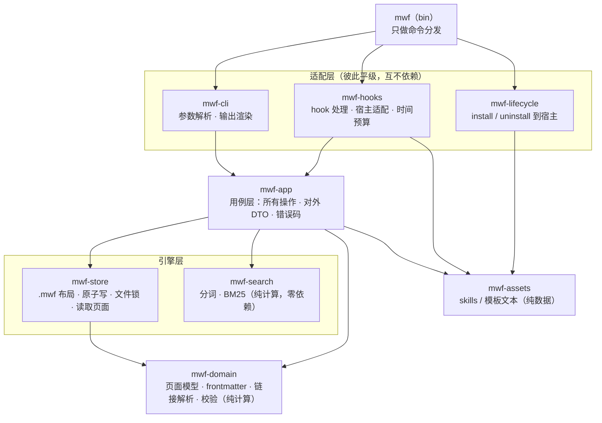

# 架构

> 状态：**已接受**（crate 拓扑与依赖规则，见 [0015](decisions/0015-crate-topology.md)）。各 crate 的职责与 API 见 [crates/](crates/)。
> 依据：[0005](decisions/0005-cargo-workspace-layering.md) 分层机制、[0006](decisions/0006-sync-first.md) 同步优先、[0008](decisions/0008-llm-wiki-division.md) wiki 引擎、[0009](decisions/0009-cli-only-no-mcp.md) 不做 MCP、[0013](decisions/0013-atomic-write-file-lock.md) 原子写与锁、[0041](decisions/0041-search-is-a-leaf.md) search 为叶子、[0042](decisions/0042-dependency-policy.md) 依赖策略、[0043](decisions/0043-errors-and-clock.md) 错误与时钟。

## 产品一句话

mwf 是一个给编程 agent 用的、项目内的 **wiki 引擎**：记忆是 `.mwf/` 下用标准 Markdown 相对链接互相引用的页面，由宿主 agent 编写；mwf 负责存储、链接、目录、BM25 搜索、lint，并通过 hooks 把相关记忆注入会话。mwf 不调用 LLM。

## crate 依赖图

箭头表示"依赖"（A → B：A 的 `Cargo.toml` 里有 B）。CI 的 `.github/scripts/check-crate-graph.sh` 断言 workspace 的 crate 与下图的节点、workspace 内的依赖与下图的 `-->` 边完全一致（只读本文第一个 mermaid 块，不认识的写法直接报错），增删 crate 或改依赖必须同时改这张图。

## 依赖规则

1. **无反向依赖**：箭头只能向下，编译器保证。
2. **适配器只看见 `mwf-app`**（外加纯数据 `mwf-assets`）：`cli` / `hooks` 不得依赖 `store`、`search`、`domain`。`mwf-app` 对外暴露自己的请求/响应类型（DTO），不透传 domain 类型。
3. **适配器之间互不依赖**。
4. **`lifecycle` 不依赖 `app`**：它只改宿主配置文件，不读写记忆数据。
5. **纯计算 crate 不做 IO**：`domain`、`search` 不触碰文件系统、时钟、环境变量；`search` 不依赖任何 workspace crate（[0041](decisions/0041-search-is-a-leaf.md)）。
6. **同步**：所有 crate 无异步运行时。
7. **bin 只做分发**：解析第一个子命令，交给对应适配器，自身不含逻辑。

## 与 TS 1.x 的对照

| 1.x | 2.x |
| --- | --- |
| `hooks → mcp → cli → core` 单链转发 | 适配器平级，都只依赖 `app` |
| core 26 个平铺文件互相依赖 | `domain`（纯）/ `search`（纯）/ `store`（IO）/ `app`（编排） |
| 分层靠正则扫 import 的测试 | crate 依赖，编译器强制 |
| SQLite FTS5 派生索引 | 无数据库；内存 BM25 + wiki 链接 |
| intent 日志、去重表、锁心跳 | 原子写 + `File::lock` |
| MCP server + CLI | 只有 CLI |
| npm 分发、依赖 Node | GitHub Releases + Homebrew，单二进制 |
